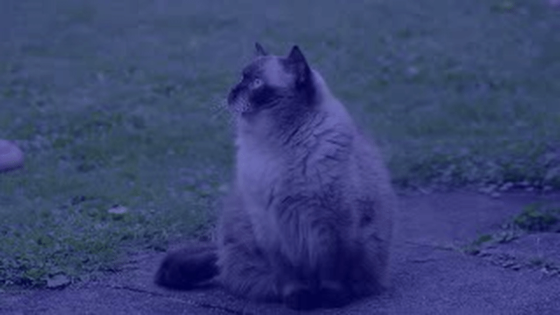

# NeuroSight

[](https://badge.fury.io/py/neurosight)
[](https://opensource.org/licenses/MIT)
[](https://github.com/CodeForgeNet/neurosight/actions)

**Lightweight motion detection inspired by the fly optic lobe.**



A lightweight, CPU-friendly motion detection library inspired by the *Drosophila* (fruit fly) visual system. NeuroSight implements a Hassenstein-Reichardt-style correlator and uses extracted T4/T5 connectome weights to produce directional motion saliency from ordinary video frames.

NeuroSight is not intended to replace full optical flow or deep models such as RAFT. Its niche is small, inspectable, biologically inspired motion detection for education, experiments, and edge-device prototypes.

## Why NeuroSight?

- **Biologically inspired**: Uses a fly-vision motion detector model with T4/T5 direction-selective weighting
- **Lightweight**: Small Python package, CPU-only, no neural-network checkpoint or GPU runtime
- **Inspectable**: The core algorithm is NumPy-based and easy to read, tune, and teach
- **Self-contained at runtime**: Ships with pre-extracted weights, so no external neuroscience API calls are required during use

### Who is this for?

- **Robotics & Edge-AI Builders**: Need simple directional motion cues on CPU-only devices.
- **Students & Researchers**: Want a compact implementation of fly-inspired motion detection.
- **Neuroscience / Computer Vision Educators**: Need a practical demo of correlator-based motion saliency.
- **Hobbyists**: Want to experiment with motion detection on webcams, Raspberry Pi-style devices, or small robots.

## Installation

### From PyPI
```bash
pip install neurosight
```

### From source
```bash
git clone https://github.com/CodeForgeNet/neurosight
cd neurosight
pip install -e .
```

## How to Use It

NeuroSight ships with pre-extracted biological connectome weights built directly into the library, so you can start detecting motion immediately.

### Quick Example: Process a Video

The simplest way to use NeuroSight is to process a video file and output an annotated video with a motion heatmap and directional arrows.

```python
from neurosight import NeuroSightDetector

detector = NeuroSightDetector()

saliency, motion_vectors = detector.process_video(
    "input.mp4",
    output_video="output_with_motion.mp4",
    overlay_vectors=True
)
```

### Real-time / Frame-by-Frame Processing

If you have exactly two frames, use the stateless pair API:

```python
from neurosight.detector import MotionDetector

detector = MotionDetector()
result = detector.process_pair(previous_frame, current_frame)

print(result.global_vector)
saliency = result.saliency_map
```

If you are reading from a webcam or integrating into a larger robotics pipeline, use the stateful API.

```python
import cv2
import time
from neurosight.detector import MotionDetector, NeuroSightConfig

# Use a preset for robust edge-device processing
config = NeuroSightConfig.preset_robust(tile_size=8)
detector = MotionDetector(config=config)
cap = cv2.VideoCapture(0)

while True:
    ret, frame_curr = cap.read()
    if not ret: break
    
    # Update the stateful detector
    result = detector.update(frame_curr, timestamp=time.time())
    
    if result is not None:
        # Display the result
        cv2.imshow("Motion Saliency", (result.saliency_map * 255).astype('uint8'))
        
        # Check Robotics outputs
        if result.looming_score and result.looming_score > 0.05:
            print(f"Collision imminent! TTC: {result.time_to_contact:.2f}s")
            
    if cv2.waitKey(1) == ord('q'): break
```

### Parameter Presets

NeuroSight ships with several config presets to help you tune for your use case immediately:

| Preset Method | Use Case | Features |
|--------------|----------|----------|
| `preset_education()` | Visualizing basic biological principles. | Slow but highly explainable. Robotics/robustness features disabled. |
| `preset_edge_fast()` | High-FPS operation on Raspberry Pi/Edge. | Single spatial scale. Heavy denoising and regions disabled. |
| `preset_robust()` | Handheld cameras, noisy environments. | Heavy temporal denoising, ego-motion, and flicker suppression on. |
| `preset_looming()` | Collision avoidance on moving robots. | Multi-scale enabled. Region extraction, looming, and steering enabled. |

You can find more detailed runnable examples in the `examples/` directory!

## What it Provides

The core detector returns a strongly-typed `MotionResult` dataclass containing:

### 1. Motion Fields & Saliency
- `saliency_map`: A 2D NumPy array representing the intensity of motion detected (scaled from `0.0` to `1.0`).
- `motion_field`: A `(H, W, 2)` NumPy array representing the horizontal and vertical unitless motion energy.
- `direction_maps`: A dictionary of `up`, `down`, `left`, `right` response grids.

### 2. Robotics & Navigation (Optional)
- `regions`: A list of dictionaries representing isolated moving components (includes `bbox`, `centroid`, `area`, `dominant_vector`).
- `looming_score`: Float representing global expansion magnitude (useful for collision).
- `time_to_contact`: Heuristic time-to-contact estimate when looming confidence is sufficient.
- `steering_signal`: A dictionary containing a `-1.0` to `1.0` `turn` signal (avoidance hook), `forward_caution`, and `collision_urgency`.

### 3. Legacy Dictionary
- `motion_vectors`: Lazy-evaluated backward compatibility property that computes per-tile vector summaries (slower).

## Architecture & Biological Background

Fly-inspired motion detection is an established research area. NeuroSight packages one practical version of that idea as a small Python library, combining a Hassenstein-Reichardt-style correlator with pre-extracted T4/T5 weighting:

- **T4/T5 Neurons**: The core of fly motion vision. T4 neurons detect moving bright edges (ON pathway), and T5 neurons detect moving dark edges (OFF pathway). Each is divided into 4 subtypes corresponding to the 4 cardinal directions (up, down, left, right).
- **Medulla Interneurons**: Signals from photoreceptors are split into L1 (light-sensitive) and L2 (dark-sensitive) channels. They pass through medulla interneurons (Mi1, Tm3, etc.) which act as temporal delay lines.
- **Hassenstein-Reichardt Correlator**: By multiplying a delayed signal from one photoreceptor with an undelayed signal from a neighboring one, the brain determines direction and speed.
- **Connectome Weights**: The included weights are derived from *Drosophila* hemibrain connectivity and normalized for this implementation.

## Performance

Current local smoke check using `NeuroSightConfig.preset_edge_fast(tile_size=8)` on a 640×480 synthetic frame pair:

| Metric | NeuroSight |
|--------|-----------:|
| Mean latency | 15.68 ms |
| p95 latency | 18.42 ms |
| Mean throughput | 63.8 FPS |

These figures are a local sanity check, not a published hardware benchmark. Real performance depends on frame size, tile size, hardware, OpenCV build, enabled options, and the scene being processed.

### Directional Synthetic Benchmark

NeuroSight also includes a small directional benchmark using both a translating square and a drifting sinusoidal grating across the four cardinal directions:

```bash
python benchmarks/run_optical_flow_benchmark.py
```

| Metric | NeuroSight | Farneback mean-flow baseline |
|--------|-----------:|-----------------------------:|
| Direction accuracy | 100.0% | 50.0% |

This benchmark tests direction recovery on simple synthetic stimuli. Farneback is summarized by a masked mean dense-flow vector, which can collapse toward zero on periodic gratings with the current parameters. Treat this as a scoped synthetic benchmark, not a general claim that classical optical flow fails.

## FAQ

**Q: Is this better than optical flow?**  
A: Not generally. NeuroSight is complementary: it provides lightweight directional motion saliency and immediate robotics abstractions (steering, looming). Classical and deep optical-flow methods are usually better when you need dense, *calibrated metric* flow vectors (i.e. pixel displacement).

**Q: Is the fly-brain idea new?**  
A: No. Hassenstein-Reichardt correlators and insect-inspired motion detectors have a long research history. NeuroSight's value is packaging the idea into a small, approachable Python library with connectome-weighted T4/T5-style directions.

**Q: Can I use this on mobile/Raspberry Pi?**  
A: Yes. It's pure Python + NumPy/OpenCV (both available on ARM).

**Q: What if I want higher accuracy?**  
A: Decrease `tile_size` (e.g., to 4 or 8) during initialization for finer spatial resolution, or use the raw motion vectors instead of the saliency map for pixel-level detail.

## License

MIT License. See `LICENSE` for details.

## Citation

If you use NeuroSight in research, please cite:

```bibtex
@software{neurosight,
  title={NeuroSight: Motion Detection Using Fly Optic Lobe Architecture},
  author={CodeForgeNet},
  year={2026},
  url={https://github.com/CodeForgeNet/neurosight}
}
```
